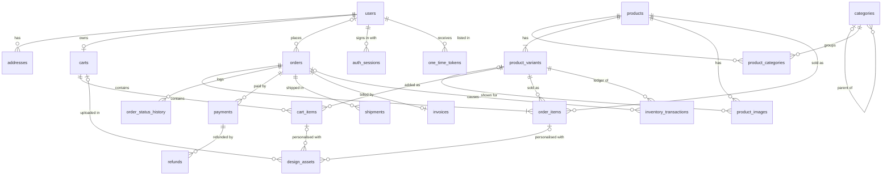
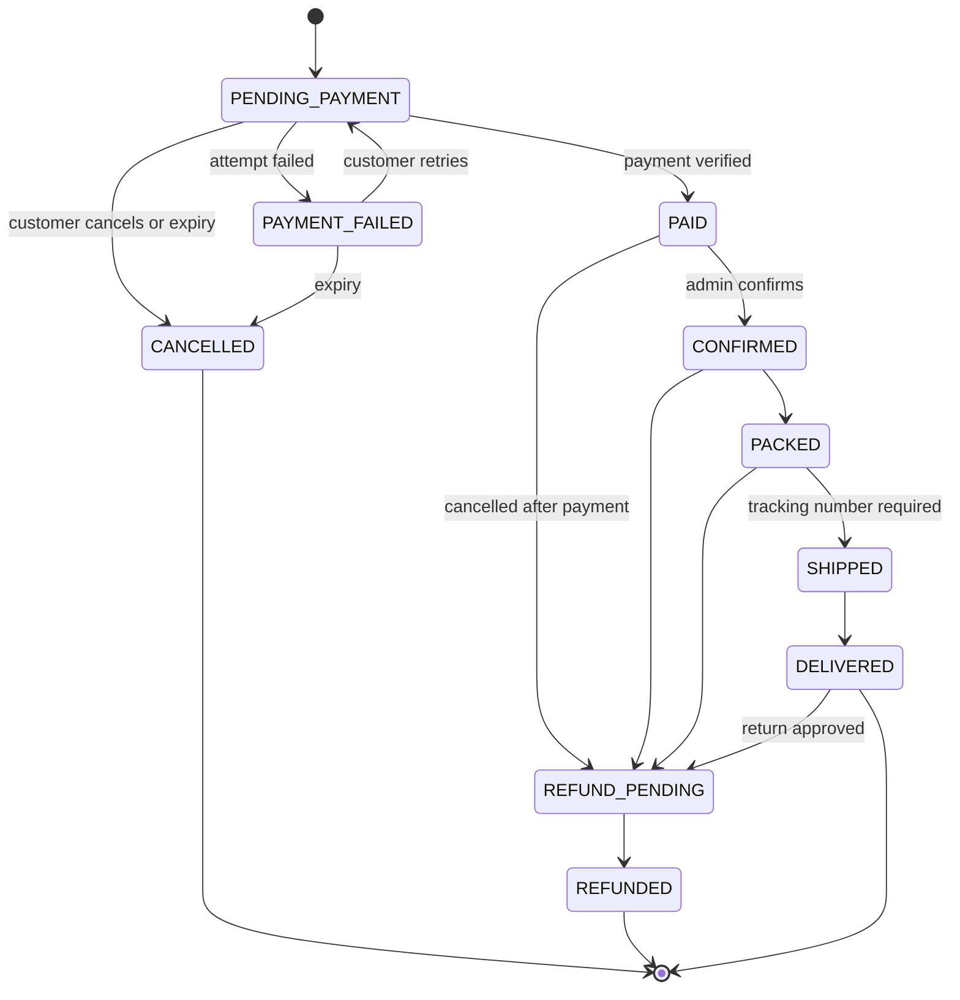

# GridCart: Database Design (Phase 1)

Status: v1, approved by the owner on 2026-11-22. Database: PostgreSQL 15 or newer. ORM: Prisma (confirmed in Phase 3).
Inputs: `Untitled Diagram.drawio` (your draft) and [REQUIREMENTS.md](REQUIREMENTS.md).

## 1. Design decisions

| # | Decision | Why | Alternative |
|---|---|---|---|
| D1 | UUID primary keys | IDs appear in URLs and API calls. Sequential IDs let anyone count orders or guess other users' IDs. Authorisation checks are still mandatory | `bigint` identity: smaller and faster, but guessable |
| D2 | Separate human-friendly `order_number`, shown as `GC-1042` | Customers and the owner quote it in emails and calls. The UUID stays internal | None |
| D3 | Money as `NUMERIC(12,2)` rupees, converted to integer paise only when talking to Razorpay | Exact decimal arithmetic and readable SQL. Never `float` | Integer paise everywhere: also correct, easier in JavaScript, harder to read |
| D4 | Price and stock live on **variants** only. Every product has at least one variant | Your draft had price and stock on both product and variant, which can disagree. One code path for cart and order lines | Product-level price plus optional variants: two code paths everywhere |
| D5 | Orders keep snapshots: product name, SKU, colour, size, image, unit price, address, customer email and phone | Editing a product or address later must not rewrite history | Joining live data: old orders change |
| D6 | Products with order history are archived, never deleted | `order_items` reference them (`RESTRICT`). "Delete" in the admin means archive | Hard delete: breaks history |
| D7 | Stock is reserved when the order is created and released if payment fails or expires | Prevents overselling at the moment of payment. Every change is written to a ledger | Decrement after payment: can sell stock that is already gone |
| D8 | Webhook events stored under `UNIQUE (provider, event_id)` | The gateway can deliver the same event more than once. The database guarantees it is processed once | Application-level check: race-prone |
| D9 | Products and categories are many-to-many | Gifts are found by type and by occasion. A photo mug can sit in "Mugs" and "Birthday" | One `category_id` (your draft): simpler, hard to change later |
| D10 | Native PostgreSQL enums for statuses | The database rejects invalid values. They match the order state machine | Free text: typos |
| D11 | `timestamptz` for every timestamp | Avoids timezone bugs. In Prisma use `@db.Timestamptz(3)` because the default maps to `timestamp` | `timestamp` |
| D12 | Carts and orders can belong to a guest | Guest checkout is required. Guests get an emailed tracking link containing a random token, stored hashed | Account required |

## 2. Changes from your draft

| Draft | Now | Reason |
|---|---|---|
| `users.address` | Removed | `addresses` is the single source of truth |
| `users.img_url` | `avatar_url` | Clearer name |
| `products.price`, `products.stock` | Removed, kept on variants | D4 |
| `products.category_id` | `product_categories` | D9 |
| `products` | Added `slug`, `status`, `is_featured`, `max_custom_images`, `customization_note`, `hsn_code`, `gst_rate` | SEO URLs, publish workflow, homepage shelves, upload limit, GST invoices |
| `product_variants.stocks` | `stock_quantity` and `track_inventory` | Ready-stock and made-to-order products in one model |
| `product_variants` | Added `compare_at_price`, `color_hex`, `low_stock_threshold`, `is_active` | Strike-through MRP, colour swatches, low-stock alerts, hiding a variant |
| `product_images` | Added `variant_id`, `public_id`, `width`, `height` | Colour-specific photos, deleting from Cloudinary, no layout shift |
| `categories` | Added `image_url`, `sort_order`, `created_at` | Category tiles and menu order |
| `orders.quantity` | Removed | Derivable from items |
| `orders.amount` | `subtotal`, `discount_amount`, `shipping_amount`, `tax_amount`, `total_amount` | The breakdown is needed for the UI, invoices and refunds |
| `orders.shipping_status` | `orders.status` plus `shipments` | One order state machine; carrier and tracking in their own table |
| `orders.payment_mode` | `payments.method` | The method belongs to the payment attempt |
| `orders.shipping_address` | JSON snapshot | D5 |
| `orders` | Added `order_number`, `customer_email`, `customer_phone`, `access_token_hash`, `expires_at`, timestamps | Guest checkout, stock reservation, notifications |
| `order_items.amount` | `unit_price` and `line_total` | Price snapshot |
| `order_items.extra_attribute` | `design_assets` table | Uploaded files need an owner, a Cloudinary id and clean-up of abandoned uploads, which a JSON column cannot give |
| `payments.transaction_id` | Removed | The gateway payment id is the transaction id. Bank references go in `gateway_payload` |
| `payments` | Added `status`, `method`, `currency`, failure fields; many payments per order | Retries after a failed attempt |
| `reviews` | Deferred until after launch | MVP scope. Sketched in section 11 |
| New tables | `carts`, `cart_items`, `design_assets`, `order_status_history`, `inventory_transactions`, `payment_webhook_events`, `refunds`, `shipments`, `store_settings`, `auth_sessions`, `one_time_tokens` | Cart persistence, audit trails, idempotent payments, refunds, owner-editable settings, login |

## 3. Entity relationship diagram

Renders on GitHub. In VS Code, install a Mermaid preview extension.



Not drawn: `store_settings` (standalone key/value table) and `payment_webhook_events` (standalone log).

## 4. Enumerations

```
user_role               CUSTOMER, ADMIN
address_label           HOME, WORK, OTHER
product_status          DRAFT, ACTIVE, ARCHIVED
order_status            PENDING_PAYMENT, PAYMENT_FAILED, PAID, CONFIRMED, PACKED, SHIPPED,
                        DELIVERED, CANCELLED, REFUND_PENDING, REFUNDED
payment_status          PENDING, PAID, FAILED, PARTIALLY_REFUNDED, REFUNDED      (on orders)
payment_attempt_status  CREATED, AUTHORIZED, CAPTURED, FAILED                    (on payments)
payment_provider        RAZORPAY
refund_status           PENDING, PROCESSED, FAILED
webhook_status          RECEIVED, PROCESSED, IGNORED, FAILED
inventory_reason        RESERVED, RELEASED, RESTOCK, ADJUSTMENT, RETURN
token_purpose           PASSWORD_RESET, EMAIL_VERIFY
```

## 5. Table definitions

Conventions: tables are plural `snake_case`. Every table has `created_at` and `updated_at` (`timestamptz NOT NULL DEFAULT now()`) unless noted. Prisma models will be singular `PascalCase` mapped with `@@map`.

### 5.1 Accounts

```
users
  id                  uuid          PK DEFAULT gen_random_uuid()
  first_name          varchar(80)   NOT NULL
  last_name           varchar(80)
  email               varchar(255)  NOT NULL UNIQUE          -- stored lower-case by the app
  phone               varchar(15)                            -- E.164, e.g. +919876543210
  password_hash       varchar(255)  NOT NULL                 -- Argon2id or bcrypt, never the password
  role                user_role     NOT NULL DEFAULT 'CUSTOMER'
  is_active           boolean       NOT NULL DEFAULT true
  avatar_url          text
  email_verified_at   timestamptz
  last_login_at       timestamptz

addresses
  id              uuid          PK
  user_id         uuid          NOT NULL -> users(id) ON DELETE CASCADE
  label           address_label NOT NULL DEFAULT 'HOME'
  recipient_name  varchar(120)  NOT NULL                     -- gifts often go to someone else
  phone           varchar(15)   NOT NULL
  line1           varchar(255)  NOT NULL
  line2           varchar(255)
  landmark        varchar(255)
  city            varchar(100)  NOT NULL
  state           varchar(100)  NOT NULL                     -- also the GST place of supply
  postal_code     char(6)       NOT NULL CHECK (postal_code ~ '^[1-9][0-9]{5}$')
  country         char(2)       NOT NULL DEFAULT 'IN'
  is_default      boolean       NOT NULL DEFAULT false
  UNIQUE INDEX (user_id) WHERE is_default                    -- one default address per user
```

### 5.2 Catalogue

```
categories
  id           uuid          PK
  parent_id    uuid          -> categories(id) ON DELETE RESTRICT   -- NULL = top level
  name         varchar(120)  NOT NULL
  slug         varchar(140)  NOT NULL UNIQUE
  description  text
  image_url    text
  sort_order   int           NOT NULL DEFAULT 0
  is_active    boolean       NOT NULL DEFAULT true
  CHECK (parent_id <> id)

products
  id                  uuid          PK
  name                varchar(200)  NOT NULL
  slug                varchar(220)  NOT NULL UNIQUE
  description         text
  status              product_status NOT NULL DEFAULT 'DRAFT'
  is_featured         boolean       NOT NULL DEFAULT false      -- homepage shelves
  is_customizable     boolean       NOT NULL DEFAULT false
  max_custom_images   smallint      NOT NULL DEFAULT 1 CHECK (max_custom_images BETWEEN 1 AND 10)
  customization_note  varchar(500)                              -- hint shown next to the uploader
  hsn_code            varchar(8)
  gst_rate            numeric(5,2)  CHECK (gst_rate BETWEEN 0 AND 100)

product_categories
  product_id   uuid  NOT NULL -> products(id)   ON DELETE CASCADE
  category_id  uuid  NOT NULL -> categories(id) ON DELETE RESTRICT
  PRIMARY KEY (product_id, category_id)                         -- no timestamps

product_variants
  id                   uuid           PK
  product_id           uuid           NOT NULL -> products(id) ON DELETE CASCADE
  sku                  varchar(64)    NOT NULL UNIQUE
  color                varchar(50)
  color_hex            char(7)        CHECK (color_hex ~ '^#[0-9A-Fa-f]{6}$')   -- swatch in the UI
  size                 varchar(30)
  price                numeric(12,2)  NOT NULL CHECK (price >= 0)               -- selling price, GST included
  compare_at_price     numeric(12,2)  CHECK (compare_at_price >= price)         -- MRP, shown struck through
  track_inventory      boolean        NOT NULL DEFAULT true                     -- false = made-to-order
  stock_quantity       int            NOT NULL DEFAULT 0 CHECK (stock_quantity >= 0)
  low_stock_threshold  int            NOT NULL DEFAULT 5
  is_default           boolean        NOT NULL DEFAULT false
  is_active            boolean        NOT NULL DEFAULT true
  UNIQUE INDEX (product_id, COALESCE(color,''), COALESCE(size,''))  -- no duplicate combinations
  UNIQUE INDEX (product_id) WHERE is_default                        -- one default variant per product

product_images
  id          uuid          PK
  product_id  uuid          NOT NULL -> products(id) ON DELETE CASCADE
  variant_id  uuid          -> product_variants(id) ON DELETE SET NULL   -- optional, colour-specific photo
  url         text          NOT NULL
  public_id   varchar(255)  NOT NULL                                     -- Cloudinary id
  alt_text    varchar(255)
  width       int
  height      int
  is_primary  boolean       NOT NULL DEFAULT false
  sort_order  int           NOT NULL DEFAULT 0
  UNIQUE INDEX (product_id) WHERE is_primary                             -- one main photo per product
```

Publish rule (service layer): a product can become `ACTIVE` only with at least one active variant with `price > 0`, at least one image, and a `gst_rate`.

### 5.3 Cart and customer uploads

```
carts
  id                uuid      PK
  user_id           uuid      UNIQUE -> users(id) ON DELETE CASCADE   -- signed-in cart
  guest_token_hash  char(64)  UNIQUE                                  -- SHA-256 of the guest cookie value
  CHECK (num_nonnulls(user_id, guest_token_hash) = 1)

cart_items
  id          uuid  PK
  cart_id     uuid  NOT NULL -> carts(id) ON DELETE CASCADE
  variant_id  uuid  NOT NULL -> product_variants(id) ON DELETE CASCADE
  quantity    int   NOT NULL CHECK (quantity BETWEEN 1 AND 50)
  -- Price is never stored: it is read live from the variant.
  -- No unique (cart_id, variant_id): two personalised lines of the same variant carry different photos.
  -- The service merges quantities for non-personalised products.

design_assets                                                          -- customer-uploaded photos
  id             uuid          PK
  cart_id        uuid          -> carts(id)       ON DELETE SET NULL   -- uploaded before it is in a line
  cart_item_id   uuid          -> cart_items(id)  ON DELETE SET NULL
  order_item_id  uuid          -> order_items(id) ON DELETE SET NULL
  url            text          NOT NULL
  public_id      varchar(255)  NOT NULL
  mime_type      varchar(50)   NOT NULL                                -- image/jpeg, image/png, image/webp
  size_bytes     int           NOT NULL
  width          int
  height         int
  CHECK (num_nonnulls(cart_item_id, order_item_id) <= 1)
  -- Orphans (both ids NULL, older than 24 h) are deleted from the table and from Cloudinary.
```

Uploads use Cloudinary's private/authenticated delivery so only the owner can open them. Verify the exact mode in Cloudinary's documentation in Phase 5.

### 5.4 Orders

```
orders
  id                   uuid           PK
  order_number         bigint         NOT NULL UNIQUE GENERATED ALWAYS AS IDENTITY (START WITH 1001)
  user_id              uuid           -> users(id) ON DELETE RESTRICT        -- NULL = guest order
  access_token_hash    char(64)                                              -- guest tracking link, SHA-256
  status               order_status   NOT NULL DEFAULT 'PENDING_PAYMENT'
  payment_status       payment_status NOT NULL DEFAULT 'PENDING'
  customer_email       varchar(255)   NOT NULL                               -- snapshot, also for guests
  customer_phone       varchar(15)    NOT NULL
  shipping_address     jsonb          NOT NULL                               -- snapshot
  subtotal             numeric(12,2)  NOT NULL                               -- sum of line totals, GST included
  discount_amount      numeric(12,2)  NOT NULL DEFAULT 0
  shipping_amount      numeric(12,2)  NOT NULL DEFAULT 0
  tax_amount           numeric(12,2)  NOT NULL DEFAULT 0                     -- GST contained in the total
  total_amount         numeric(12,2)  NOT NULL                               -- what the customer pays
  currency             char(3)        NOT NULL DEFAULT 'INR'
  coupon_code          varchar(50)                                           -- snapshot; coupons arrive later
  customer_note        text
  admin_note           text
  expires_at           timestamptz                                           -- unpaid orders release stock after this
  paid_at              timestamptz
  cancelled_at         timestamptz
  cancellation_reason  varchar(500)
  CHECK (subtotal >= 0 AND discount_amount >= 0 AND shipping_amount >= 0 AND total_amount >= 0)
  CHECK (total_amount = subtotal - discount_amount + shipping_amount)

order_items
  id            uuid           PK
  order_id      uuid           NOT NULL -> orders(id)           ON DELETE CASCADE
  product_id    uuid           NOT NULL -> products(id)         ON DELETE RESTRICT
  variant_id    uuid           NOT NULL -> product_variants(id) ON DELETE RESTRICT
  product_name  varchar(200)   NOT NULL                          -- snapshot
  sku           varchar(64)    NOT NULL                          -- snapshot
  color         varchar(50)                                      -- snapshot
  size          varchar(30)                                      -- snapshot
  image_url     text                                             -- snapshot of the main photo
  unit_price    numeric(12,2)  NOT NULL CHECK (unit_price >= 0)  -- GST included
  quantity      int            NOT NULL CHECK (quantity > 0)
  line_total    numeric(12,2)  NOT NULL
  hsn_code      varchar(8)                                       -- snapshot, for the invoice
  gst_rate      numeric(5,2)                                     -- snapshot
  tax_amount    numeric(12,2)  NOT NULL DEFAULT 0                -- line_total * rate / (100 + rate), rounded
  CHECK (line_total = unit_price * quantity)

order_status_history                                             -- no updated_at
  id           uuid          PK
  order_id     uuid          NOT NULL -> orders(id) ON DELETE CASCADE
  from_status  order_status                                      -- NULL on the first row
  to_status    order_status  NOT NULL
  changed_by   uuid          -> users(id) ON DELETE SET NULL     -- NULL = system or webhook
  note         text

inventory_transactions                                           -- stock ledger, no updated_at
  id               uuid              PK
  variant_id       uuid              NOT NULL -> product_variants(id) ON DELETE RESTRICT
  quantity_change  int               NOT NULL CHECK (quantity_change <> 0)   -- negative = stock out
  stock_after      int               NOT NULL
  reason           inventory_reason  NOT NULL
  order_id         uuid              -> orders(id) ON DELETE SET NULL
  created_by       uuid              -> users(id)  ON DELETE SET NULL
  note             varchar(255)
```

### 5.5 Payments, refunds, shipping

```
payments
  id                  uuid                    PK
  order_id            uuid                    NOT NULL -> orders(id) ON DELETE RESTRICT   -- many attempts per order
  provider            payment_provider        NOT NULL DEFAULT 'RAZORPAY'
  gateway_order_id    varchar(64)             NOT NULL UNIQUE                            -- order_xxx
  gateway_payment_id  varchar(64)             UNIQUE                                     -- pay_xxx, known after payment
  amount              numeric(12,2)           NOT NULL CHECK (amount > 0)
  currency            char(3)                 NOT NULL DEFAULT 'INR'
  status              payment_attempt_status  NOT NULL DEFAULT 'CREATED'
  method              varchar(30)                                                         -- upi, card, netbanking, wallet
  failure_code        varchar(100)
  failure_reason      varchar(500)
  verified_at         timestamptz                                                         -- signature check passed
  gateway_payload     jsonb                                                               -- trimmed gateway response, never card data

payment_webhook_events                                           -- no updated_at
  id            uuid            PK
  provider      payment_provider NOT NULL
  event_id      varchar(100)    NOT NULL                          -- from the gateway's event-id header
  event_type    varchar(100)    NOT NULL
  payload       jsonb           NOT NULL
  status        webhook_status  NOT NULL DEFAULT 'RECEIVED'
  error         text
  received_at   timestamptz     NOT NULL DEFAULT now()
  processed_at  timestamptz
  UNIQUE (provider, event_id)

refunds
  id                 uuid           PK
  payment_id         uuid           NOT NULL -> payments(id) ON DELETE RESTRICT
  gateway_refund_id  varchar(64)    UNIQUE
  amount             numeric(12,2)  NOT NULL CHECK (amount > 0)
  reason             varchar(500)
  status             refund_status  NOT NULL DEFAULT 'PENDING'
  initiated_by       uuid           -> users(id) ON DELETE SET NULL
  processed_at       timestamptz
  -- Sum of refunds per payment <= payment amount: enforced by the service inside a transaction.

shipments
  id               uuid          PK
  order_id         uuid          NOT NULL -> orders(id) ON DELETE CASCADE
  carrier          varchar(80)
  tracking_number  varchar(100)
  tracking_url     text
  shipped_at       timestamptz
  delivered_at     timestamptz
```

### 5.6 Settings and login

```
store_settings
  key         varchar(100)  PK                        -- 'shipping', 'store_profile'
  value       jsonb         NOT NULL                  -- validated by the API before saving
  updated_by  uuid          -> users(id) ON DELETE SET NULL
  updated_at  timestamptz   NOT NULL DEFAULT now()
  -- shipping:      { flat_fee, free_above }                          values chosen by the owner
  -- store_profile: { legal_name, gstin, address, state, support_email, support_phone }

auth_sessions                                           -- final shape confirmed in Phase 4
  id          uuid          PK
  user_id     uuid          NOT NULL -> users(id) ON DELETE CASCADE
  token_hash  char(64)      NOT NULL UNIQUE
  user_agent  varchar(255)
  ip          inet
  expires_at  timestamptz   NOT NULL
  revoked_at  timestamptz

one_time_tokens                                         -- password reset, email verification
  id          uuid           PK
  user_id     uuid           NOT NULL -> users(id) ON DELETE CASCADE
  purpose     token_purpose  NOT NULL
  token_hash  char(64)       NOT NULL UNIQUE
  expires_at  timestamptz    NOT NULL
  used_at     timestamptz
```

### 5.7 Invoices (added 2026-11-22: automatic GST invoices are in launch scope)

```
invoices
  id                uuid          PK
  order_id          uuid          NOT NULL UNIQUE -> orders(id) ON DELETE RESTRICT   -- one invoice per order
  financial_year    char(7)       NOT NULL                                           -- '2026-27'
  sequence_number   int           NOT NULL CHECK (sequence_number > 0)
  invoice_number    varchar(30)   NOT NULL UNIQUE                                    -- 'GC/2026-27/0001'
  issued_at         timestamptz   NOT NULL DEFAULT now()
  seller_snapshot   jsonb         NOT NULL                                           -- legal name, GSTIN, address, state
  buyer_snapshot    jsonb         NOT NULL                                           -- name, address, state, optional GSTIN
  tax_breakdown     jsonb         NOT NULL                                           -- per line: taxable value, CGST+SGST or IGST
  pdf_key           text                                                             -- private storage key of the PDF
  UNIQUE (financial_year, sequence_number)                                           -- numbers run without gaps within a year
```

Rules (service layer): the invoice is created inside the same transaction that marks the order PAID, taking the next number for the financial year (1 April to 31 March) under a lock so numbers are sequential and unique. Seller and buyer details are snapshots, so later edits never change an issued invoice. Tax split: if the delivery state equals the seller's state (Tamil Nadu) the GST is CGST plus SGST; otherwise IGST. Line values come from `order_items` (`hsn_code`, `gst_rate`, `tax_amount`). A refund after an invoice is issued normally needs a credit note; confirm with your CA whether that is needed at launch.

## 6. Relationship mapping

| Parent | Child | Cardinality | Foreign key | On delete |
|---|---|---|---|---|
| users | addresses | 1 to many | `addresses.user_id` | CASCADE |
| users | carts | 1 to 0..1 | `carts.user_id` | CASCADE |
| users | orders | 0..1 to many (NULL = guest) | `orders.user_id` | RESTRICT |
| categories | categories | 1 to many (self) | `parent_id` | RESTRICT |
| products and categories | product_categories | many to many | both columns | CASCADE on product, RESTRICT on category |
| products | product_variants | 1 to 1..many | `product_id` | CASCADE |
| products | product_images | 1 to many | `product_id` | CASCADE |
| product_variants | product_images | 0..1 to many | `variant_id` | SET NULL |
| carts | cart_items | 1 to many | `cart_id` | CASCADE |
| product_variants | cart_items | 1 to many | `variant_id` | CASCADE |
| carts, cart_items, order_items | design_assets | 0..1 to many | `cart_id`, `cart_item_id`, `order_item_id` | SET NULL |
| orders | order_items | 1 to 1..many | `order_id` | CASCADE |
| products, product_variants | order_items | 1 to many | `product_id`, `variant_id` | RESTRICT |
| orders | order_status_history | 1 to many | `order_id` | CASCADE |
| orders | payments | 1 to many (retries) | `order_id` | RESTRICT |
| payments | refunds | 1 to many | `payment_id` | RESTRICT |
| orders | shipments | 1 to many | `order_id` | CASCADE |
| product_variants | inventory_transactions | 1 to many | `variant_id` | RESTRICT |
| orders | invoices | 1 to 0..1 | `order_id` | RESTRICT |

Rule behind the table: financial and history records (`payments`, `refunds`, anything pointing at products that were sold) use `RESTRICT` so they cannot disappear by accident. Accounts are never hard-deleted; an account deletion request anonymises the user row and keeps the orders.

## 7. Constraints: where each rule is enforced

| Rule | Enforced by |
|---|---|
| No negative stock | `CHECK (stock_quantity >= 0)` |
| No overselling | Conditional `UPDATE ... WHERE stock_quantity >= :qty` inside the order transaction (service), with the CHECK as last line of defence |
| Order totals add up | `CHECK` on `orders` and `order_items` |
| One default address per user, one default variant and one main image per product | Partial unique indexes |
| No duplicate variant combination | Expression unique index |
| A cart belongs to exactly one of user or guest | `CHECK (num_nonnulls(...) = 1)` |
| Unique email, SKU, slug, order number | `UNIQUE` |
| Webhook processed once | `UNIQUE (provider, event_id)` |
| Valid order status transitions | Service (one transition map), each change writes `order_status_history` |
| Product cannot go live without price, image and GST rate | Service |
| Refunds never exceed the paid amount | Service, in a transaction that locks the payment row |
| Paid orders are immutable | Service: no endpoint edits items or prices after payment |

Prisma's schema language cannot express partial indexes, expression indexes or `CHECK` constraints (at the time of writing). They are added as raw SQL in the migration file: run `prisma migrate dev --create-only`, edit the SQL, then apply.

## 8. Indexing strategy

Primary keys and `UNIQUE` constraints already create indexes. Additional ones:

| Table | Index | Serves |
|---|---|---|
| products | `(status, created_at DESC)` | Storefront listing, newest first |
| products | partial `(created_at DESC) WHERE status = 'ACTIVE' AND is_featured` | Homepage shelves |
| products | GIN `name gin_trgm_ops` (extension `pg_trgm`) | Search by name, tolerant of typos |
| product_categories | `(category_id, product_id)` | Products in a category |
| categories | `(parent_id, sort_order)` | Menu tree |
| product_variants | `(product_id)` | Variants of a product |
| product_images | `(product_id, sort_order)` | Gallery order |
| addresses | `(user_id)` | Address book |
| cart_items | `(cart_id)` | Loading a cart |
| design_assets | `(cart_item_id)`, `(order_item_id)`, partial `(created_at) WHERE cart_item_id IS NULL AND order_item_id IS NULL` | A line's files; orphan clean-up |
| orders | `(user_id, created_at DESC)` | My Orders |
| orders | `(status, created_at DESC)` | Admin queue by status |
| orders | `(customer_email)` | Finding a customer's orders |
| orders | partial `(expires_at) WHERE status IN ('PENDING_PAYMENT','PAYMENT_FAILED')` | Expiry job |
| order_items | `(order_id)`, `(variant_id)` | Order detail; sales per product |
| order_status_history | `(order_id, created_at)` | Timeline |
| payments | `(order_id)` | Payments of an order |
| refunds | `(payment_id)` | Refunds of a payment |
| shipments | `(order_id)` | Shipment of an order |
| inventory_transactions | `(variant_id, created_at DESC)` | Ledger per variant |
| auth_sessions | `(user_id)`, `(expires_at)` | Sessions per user; purge |

Rule of thumb: index foreign keys and the columns you filter or sort by, nothing more, because every index slows writes. Re-check with `EXPLAIN ANALYZE` once there is real data.

## 9. Critical operations

### 9.1 Place an order

1. Read the cart and load each variant with its current price and stock. Prices from the browser are ignored.
2. Validate: product `ACTIVE`, variant active, quantity within limits, customisable products have 1 to `max_custom_images` uploaded photos.
3. Compute subtotal, shipping (from `store_settings`), GST portion and total.
4. Start a transaction. For each variant with `track_inventory = true`, sorted by id to avoid deadlocks:

   ```sql
   UPDATE product_variants
   SET stock_quantity = stock_quantity - :qty
   WHERE id = :id AND stock_quantity >= :qty;
   -- 0 rows updated: not enough stock, roll back and tell the customer
   ```

5. Insert the order (`PENDING_PAYMENT`, `expires_at` = now + 30 minutes), its items with snapshots, the first history row and one `RESERVED` ledger row per tracked variant. Move the uploaded photos from the cart line to the order item. Commit.
6. Outside the transaction, create the Razorpay order (amount in paise) and insert the `payments` row. If the gateway call fails, cancel the order and release the stock.

### 9.2 Confirm a payment

Runs from the checkout verify endpoint and from the webhook. Both must be safe to repeat.

1. Verify the HMAC signature (checkout response, or webhook body). Reject on mismatch.
2. Webhook only: insert into `payment_webhook_events`. If the unique key already exists, stop: duplicate delivery.
3. In one transaction: mark the payment `CAPTURED`, move the order `PENDING_PAYMENT` or `PAYMENT_FAILED` to `PAID` with a guarded update (`WHERE status IN (...)`), write history. Zero rows changed means it was already processed.
4. Compare the captured amount with the order total. A mismatch is flagged for manual review instead of confirming.
5. Late payment on an order that already expired: try to reserve the stock again; if that fails, refund automatically and email the customer.
6. After commit, send the emails.

### 9.3 Cancel or expire an unpaid order

Guarded status update to `CANCELLED`, then release the stock (`RELEASED` ledger rows) for tracked variants. A scheduled job runs every few minutes and asks Razorpay for the payment state first, because the customer may be paying at that moment.

### 9.4 Admin stock change

One transaction: update `stock_quantity` and write an `ADJUSTMENT` ledger row with the difference.

### 9.5 Refund

Lock the payment row, check that existing refunds plus the new amount do not exceed the payment, insert the refund as `PENDING`, set the order to `REFUND_PENDING` for a full refund, then call the gateway. The refund webhook marks it `PROCESSED`, sets the order and payment to `REFUNDED` (or `PARTIALLY_REFUNDED`, which leaves the order status unchanged) and restocks items that never shipped.

### 9.6 Clean-up jobs

- Expire unpaid orders (every few minutes).
- Delete orphan `design_assets` older than 24 hours, including the Cloudinary files.
- Delete guest carts idle for 30 days.
- Delete expired sessions and tokens daily.

## 10. Order state machine



`CANCELLED` is only for orders that never took money. A paid order that is cancelled goes through `REFUND_PENDING` to `REFUNDED`, and the UI shows "Cancelled, refund in progress" using `cancelled_at`. A shipped order cannot be cancelled; it needs the return flow. `payment_status` mirrors the money side and `status` the fulfilment side; both change in the same transaction. A partial refund changes only `payment_status`.

## 11. Migration plan

| Step | Migration | Contents |
|---|---|---|
| 0 | Setup | Create the database, initialise Prisma, enable `pg_trgm` |
| 1 | `accounts` | Enums `user_role`, `address_label`; `users`, `addresses` |
| 2 | `catalogue` | `categories`, `products`, `product_categories`, `product_variants`, `product_images`, plus CHECKs and partial or expression indexes |
| 3 | `cart` | `carts`, `cart_items`, `design_assets` (the `order_item_id` foreign key is added in step 4) |
| 4 | `orders` | Order enums, `orders`, `order_items`, `order_status_history`, `inventory_transactions`, `order_number` identity, totals CHECKs |
| 5 | `payments` | `payments`, `payment_webhook_events`, `refunds`, `shipments`, `invoices` |
| 6 | `settings_and_auth` | `store_settings`, `auth_sessions`, `one_time_tokens` |
| 7 | Seed (script, not a migration) | Admin user from environment variables, base categories, default settings, draft products imported from `assets\productPhotos` |

Workflow: `prisma migrate dev` locally, commit the migration files, `prisma migrate deploy` from CI for production. Never edit a migration that has been applied. On a live database, add columns first and remove old ones only after the code stops using them. Take a backup before risky migrations.

After launch (sketches):

- `coupons` (code, type PERCENT or FLAT, value, minimum order, validity, usage limits) and `coupon_redemptions` (coupon, order, customer).
- `reviews` (from your draft): `product_id`, `user_id`, `order_item_id` for verified purchases, `rating` 1 to 5, `title`, `comment`, `images jsonb` (your `extra_attribute`), `status` PENDING, APPROVED or REJECTED. `UNIQUE (user_id, product_id)`.
- `wishlists` (user, product).
- `credit_notes` (invoice, refund, amount, sequential number). Needed when a refund follows an issued invoice; confirm with your CA whether it is required at launch.

## 12. Open items

1. Product browsing model (requirements question 1). The schema already supports several categories per product.
2. GST on the shipping fee, credit notes for refunds, and the invoice number format (requirements question 4). Confirm with your CA.
3. Stock reservation window: 30 minutes is the default. Confirm.
4. Session strategy (cookie sessions or tokens) is decided in Phase 4; `auth_sessions` may change shape.
5. Variants beyond colour and size (for example material or capacity). If the product list needs them, add an `attributes jsonb` column to `product_variants`.
